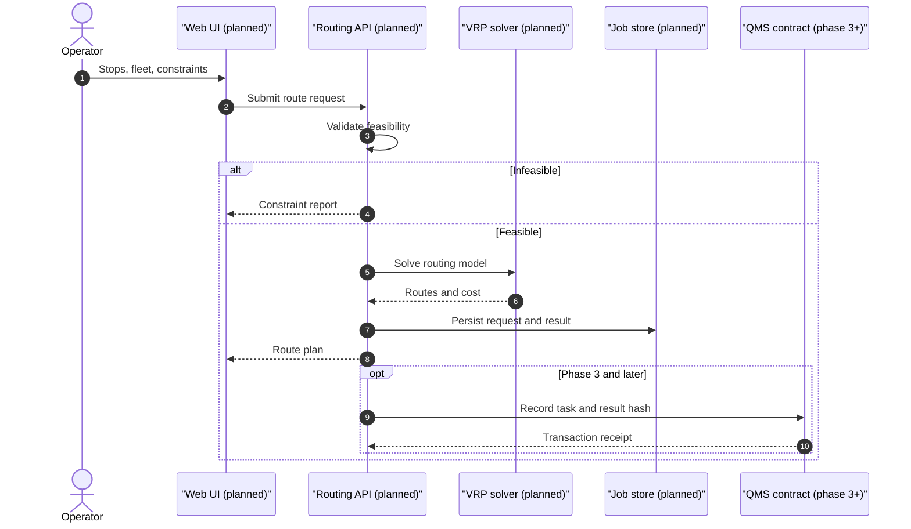
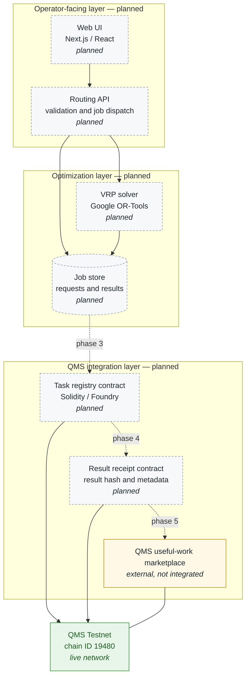

<div align="center">

# QMS Route

**Vehicle routing optimization for small delivery fleets — open optimization algorithms, with verifiable route records on QMS as the long-term goal.**

[](#project-status)
[](#qms-testnet-configuration)
[](#license)

</div>

> **Project status: pre-implementation.**
> This repository currently contains **no application code, no smart contracts, no tests, and no deployment artifacts** — it has no commits yet. Everything in this document describes intended design unless it is explicitly labelled as current. See [Project Status](#project-status) before relying on any statement here.

---

## Overview

Delivery routing is a solved problem in research and an unsolved one in practice. A small courier company with three vans, forty stops, and per-stop time windows still plans its day in a spreadsheet, because commercial vehicle routing software is priced and packaged for enterprises, and open-source solvers assume an operations-research team to run them.

**QMS Route is intended to be a free routing tool for exactly that gap**: an operator enters delivery locations, vehicle capacities, and routing constraints, and receives an efficient, human-readable route plan computed with open-source optimization algorithms — no license fee, no solver expertise required.

### Who it is for

| Audience | What they need | What QMS Route aims to provide |
| --- | --- | --- |
| Small delivery businesses | A workable route plan without enterprise software | Constraint-aware routes from a simple input form |
| Logistics operators | Repeatable planning across many vehicles and shifts | Capacity, time-window, and depot constraints in one model |
| Independent merchants | Occasional multi-stop planning on a budget | A free tool with no account or subscription wall |
| Developers | A real-world optimization example on an EVM chain | A readable reference implementation on QMS |

### The problem, concretely

Given a depot, a set of stops with demand and time windows, and a fleet with capacities, find a set of routes that serves every stop at minimum cost. That is the capacitated vehicle routing problem with time windows (CVRPTW) — NP-hard, routinely solved well enough in practice by metaheuristics, and still out of reach for a merchant with a spreadsheet.

---

## Why QMS?

QMS (Quantum Monetary System) is a Layer-1 blockchain built for the post-quantum era. Its consensus layer, Casimir, uses **proof-of-useful-work**: miners run solvers against real optimization problems instead of computing hashes, with quadratic unconstrained binary optimization (QUBO) as the initial problem class. Commercial clients post problems to an on-chain marketplace, lock payment in a smart contract, and miners are paid for good solutions. On QMS, optimization is not a workload bolted onto a payment chain — it is the security mechanism.

That makes route optimization a natural fit rather than an arbitrary dApp:

- **The workload class matches.** Routing problems are combinatorial optimization. CVRP-class problems admit QUBO formulations with penalty terms for capacity and assignment constraints — the same family QMS targets. The mapping is well studied, not speculative.
- **Results become verifiable.** A route plan is only useful if the operator can show what was promised and what was delivered. Recording a task commitment and a result hash on an EVM-compatible chain gives a cheap, tamper-evident audit trail that a CSV export cannot.
- **Optimization work has economic value.** The long-term direction is a marketplace where a routing job is a posted problem with a price, solved by whoever can solve it best — which is precisely the shape of the QMS useful-work marketplace.

**What this project does not claim:** QMS Route has no integration with QMS miners, the QMS useful-work marketplace, or any QMS protocol component. Nothing in this repository submits work to the network, and no contract has been written or deployed. The alignment described here is architectural intent, and the integration work is planned in [Roadmap](#roadmap) phases 3–5.

---

## How It Works

### Intended workflow

1. **Describe the problem.** The operator supplies a depot, stops with coordinates and demand, vehicle count and capacity, and optional constraints (time windows, service duration, shift length).
2. **Validate.** Inputs are checked for feasibility — demand exceeding total fleet capacity, unreachable stops, contradictory windows — and rejected with an actionable message rather than an infeasible plan.
3. **Build the model.** The request is converted into a routing model with a cost matrix (distance or duration) and the declared constraints.
4. **Solve.** A metaheuristic search over the model produces routes and a cost breakdown.
5. **Present.** The operator sees per-vehicle routes in stop order, total distance and duration, per-vehicle load, and any constraint that had to be relaxed.
6. **Record (later phase).** A hash of the request and result is written to a QMS contract, producing a verifiable record of the optimization task.

The same flow as a sequence, with every participant except the operator marked as planned:



### Component status

| Component | Intended role | Status |
| --- | --- | --- |
| Input schema and validation | Normalize and feasibility-check route requests | Planned |
| Cost matrix builder | Distance/duration matrix from coordinates | Planned |
| Routing solver | CVRPTW optimization via Google OR-Tools | Planned |
| Web interface | Operator-facing input form and route view | Planned |
| HTTP API | Programmatic job submission and retrieval | Planned |
| Job store | Persist requests, results, and provenance | Planned |
| Task registry contract | On-chain commitment for a routing job | Planned |
| Result receipt contract | On-chain hash and metadata of a result | Planned |
| QMS useful-work marketplace link | Post routing jobs as network problems | Future — not designed |

There is no runnable component today. Step 6 and everything in the on-chain rows are design targets, not features in progress.

---

## Features

### Implemented

**None.** The repository has no source files. Any feature list claiming otherwise would be inaccurate; this section will be populated only when code exists and runs.

### Planned

**Routing core**

| Feature | Description | Phase |
| --- | --- | --- |
| Multi-vehicle route planning | Assign stops across a heterogeneous fleet | 1 |
| Capacity constraints | Respect per-vehicle weight and volume limits | 1 |
| Time windows | Honor per-stop delivery windows and service times | 2 |
| Depot start/end | Single depot with return-to-base routing | 1 |
| Cost matrix support | Distance or duration matrices, pluggable provider | 2 |
| Infeasibility reporting | Explain why a request cannot be served | 2 |
| Route export | Human-readable plan and machine-readable JSON | 2 |

**Platform**

| Feature | Description | Phase |
| --- | --- | --- |
| Web interface | Form-based input plus map and route table | 1 |
| HTTP API | Submit a job, poll status, fetch results | 2 |
| Reproducible jobs | Store solver parameters with each result | 2 |
| Scenario comparison | Compare plans across fleet sizes or constraints | 3 |

**On-chain**

| Feature | Description | Phase |
| --- | --- | --- |
| Task commitment | Register a routing job with its parameters hash | 3 |
| Result attestation | Anchor a result hash and solver metadata | 4 |
| Verification workflow | Recompute or dispute a recorded result | 4 |
| Marketplace listing | Offer routing jobs as QMS useful-work problems | 5 |

Planned items are not commitments to a schedule. They describe intended scope so that contributors can see where a piece of work fits.

---

## Architecture

The diagram shows the intended system. **Nothing in it is implemented**: dashed nodes are planned components, the amber node is external QMS infrastructure this project does not integrate with, and the green node is the live testnet that future contracts would target.



### Design intent

- **Solver behind an interface.** The optimization step is kept behind a narrow boundary so that OR-Tools can be replaced or supplemented without touching the API or the chain layer.
- **Off-chain computation, on-chain provenance.** Full route geometry stays off-chain; only commitments and hashes are intended to be recorded, because per-stop data on-chain would be both expensive and a privacy problem for the operator's customers.
- **One direction of trust.** Contracts are designed to record what the service computed, not to re-run the optimizer. Verification is by hash and, in phase 4, by optional recomputation with stored parameters.

---

## Technology Stack

### Currently in the repository

| Category | Present |
| --- | --- |
| Languages | None |
| Frameworks | None |
| Package manifests | None — no `package.json`, `pyproject.toml`, `requirements.txt`, `foundry.toml`, or lockfile exists |
| Smart contracts | None |
| CI/CD | None |
| Tests | None |

### Planned stack

These are intended choices, not installed dependencies. Each will be added with a manifest and documented commands when its phase begins.

| Technology | Role | Why | Status |
| --- | --- | --- | --- |
| Next.js / React | Web interface | Server rendering plus a component model suited to form-heavy tools | Planned |
| Python | Optimization service | The mature OR-Tools and scientific Python ecosystem | Planned |
| Google OR-Tools | Routing solver | Open source, production-grade CVRP/CVRPTW support | Planned |
| Solidity | QMS contracts | EVM target for commitments and receipts | Planned |
| Foundry | Contract development | Fast test loop and scripting for deployment | Planned |
| QMS Testnet | Target network | EVM-compatible with optimization-native consensus | Planned |

The stack is deliberately conservative: every component is chosen because it is the boring, well-supported option for its job, not because it is novel.

---

## QMS Testnet Configuration

Values below are from the official QMS documentation. The chain ID, RPC endpoint, execution client, and the explorer, faucet, and status pages were checked against the live network on **2026-11-02**.

| Parameter | Value |
| --- | --- |
| Network name | QMS Testnet |
| Chain ID | `19480` (`0x4c18`) |
| RPC URL | `https://rpc.testnet.qms.finance` |
| WebSocket RPC | `wss://rpc.testnet.qms.finance` |
| Currency symbol | QMS |
| Block explorer | https://testnet.qmsscan.io |
| Faucet | https://faucet.testnet.qms.finance |
| Status page | https://status.testnet.qms.finance |
| Execution client | `reth` |
| Fee model | EIP-1559 |

### Connect a wallet

Add a custom EVM network in MetaMask (or any wallet that supports custom networks) using the values above, then switch to **QMS Testnet**. Test tokens come from the faucet; per QMS documentation it issues 10 QMS per request with a limit of four requests per 24 hours.

### Verify the endpoint

You can confirm the chain ID without trusting this README:

```bash
curl -s -X POST https://rpc.testnet.qms.finance \
  -H 'Content-Type: application/json' \
  -d '{"jsonrpc":"2.0","id":1,"method":"eth_chainId","params":[]}'
```

A correct endpoint returns:

```json
{"jsonrpc":"2.0","id":1,"result":"0x4c18"}
```

`0x4c18` is `19480` in decimal. If a wallet reports a different chain ID, the RPC URL is wrong.

### Current limitations of the testnet

- Post-quantum wallet signing is **not** available in the current testnet release; transactions are signed with standard EVM keys.
- QMS states that the testnet may be reset for major upgrades, clearing balances, history, and contract state. Treat any future deployment here as disposable.
- Test tokens have no monetary value. Do not send real funds to any testnet address.

QMS Route does not require a wallet connection today, because there is nothing to connect to yet. Contract development is scheduled in [Roadmap](#roadmap) phase 3.

---

## Installation and Local Development

**There is nothing to install or run.** This repository has no source code, no package manifest, and no build configuration, so it has no setup procedure and no test command.

Running `npm install`, `pip install`, or `forge build` here would not do anything useful — there is no `package.json`, no requirement file, and no Foundry project.

When phase 1 lands, this section will document the real commands, verified against the code in this repository:

- prerequisites and versions,
- dependency installation for each package,
- environment variables and example files,
- how to start each service locally,
- how to run the test suites,
- how to run the contracts against QMS Testnet.

Until then, no installation instructions exist. Setup steps published elsewhere do not describe this repository.

---

## Usage

**No functionality is currently usable.** There is no interface, no API, and no contract.

For clarity about where this is heading, the intended interaction is a route request in, a route plan out. The shape below is a **design sketch, not an implemented schema** — field names and structure will change when the API is built:

```jsonc
// Design sketch — not implemented, not a stable interface
{
  "depot": { "lat": 30.0444, "lng": 31.2357 },
  "vehicles": [{ "id": "van-1", "capacity": 120 }],
  "stops": [
    { "id": "s1", "lat": 30.0611, "lng": 31.2489, "demand": 12,
      "window": ["09:00", "12:00"], "serviceMinutes": 10 }
  ]
}
```

The intended response reports per-vehicle stop order, total distance and duration, per-vehicle load, and any relaxed constraint. Nothing consumes or produces this today.

---

## Roadmap

| Phase | Scope | Deliverable | Status |
| --- | --- | --- | --- |
| 0 | Repository and specification | This README, problem definition, interface sketch | **Current** |
| 1 | Initial prototype | Single-vehicle and small-fleet planning, web form, OR-Tools integration | Planned |
| 2 | Routing optimization | Capacity, time windows, cost matrices, infeasibility reporting, API | Planned |
| 3 | QMS smart contract integration | Task registry and result receipt contracts on QMS Testnet | Planned |
| 4 | Verifiable optimization records | Result hashing, solver metadata, recomputation and dispute path | Planned |
| 5 | Useful-work marketplace alignment | Evaluate posting routing jobs as QMS optimization problems | Research |

Phase 5 is research, not a commitment. It depends on QMS marketplace interfaces that this project does not control, and it should only be attempted if the problem encoding is honest — a routing job dressed up as a QUBO instance that no solver can use would be worse than no integration.

---

## Project Status

| Dimension | State |
| --- | --- |
| Stage | Pre-implementation (specification) |
| Source code | None |
| Tests | None |
| Smart contracts | None |
| Deployed addresses | None — no contract has been deployed, and none is referenced in this repository |
| CI / workflows | None |
| Commits | None — the repository was created on 2026-11-02 and has no commits |
| Documentation | This README only |
| License | Not declared (see [License](#license)) |

This project is at the stage where the design is being written down before code exists. That is intentional: the routing model and the on-chain record format are the decisions that are expensive to change later, and cheap to get right now.

---

## Contributing

The most useful contribution today is critique, not code.

- **Challenge the design.** Open an issue if the input schema, the constraint set, or the on-chain record format is wrong for a real delivery operation. Concrete counterexamples — a fleet this model cannot express, a constraint that is missing — are worth more than feature requests.
- **Propose a phase.** If you want to build a component, open an issue describing scope, interface, and how it will be tested before writing it, so the interface can be agreed first.
- **Bring real data shapes.** Anonymized examples of how small operators actually describe their routes are the hardest input to get and the most valuable.

Once code exists, this section will specify the branch and review conventions, test requirements, and commit style. No CLA or code of conduct exists yet, so expect those conventions to be defined before the first external pull request is reviewed.

---

## License

**No license file exists in this repository.** The repository was created without one, and this README does not assign a license: absent an explicit license, default copyright applies and no reuse rights are granted.

No license has been selected yet. Until a `LICENSE` file is present, do not assume the project may be copied, modified, or redistributed. Check the repository for that file rather than relying on this section.

---

## Disclaimer

QMS Route is an **independent project**. It is not an official QMS product, and it is not affiliated with, endorsed by, or sponsored by QMS Network. "QMS" and related names belong to their respective owners; references here describe a public network this project intends to build on.

The project is not audited and has no production deployment. Any future contracts should be treated as experimental. Nothing here is financial advice, and nothing in this repository should be read as a promise of token value, rewards, or returns.

Testnet only: test tokens have no monetary value, the network may be reset without notice, and no real funds should ever be sent to a testnet address. Route plans produced by this software would be advisory — the operator remains responsible for legal, safety, and delivery commitments.
